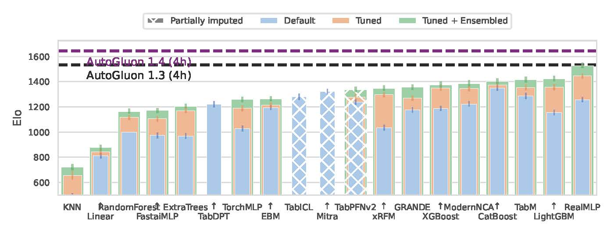
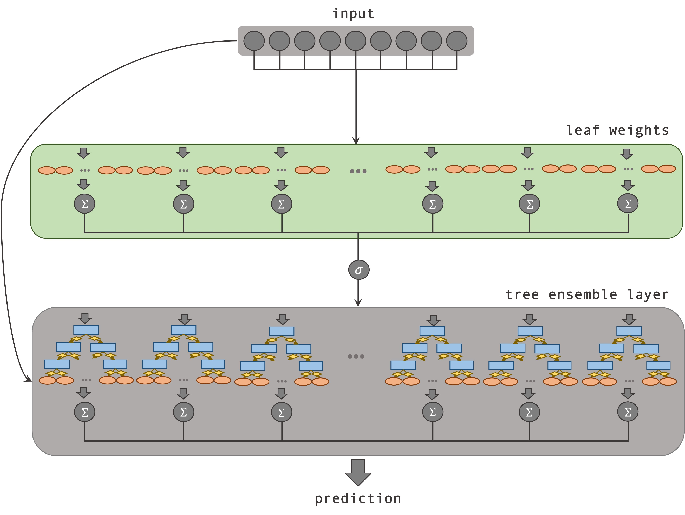
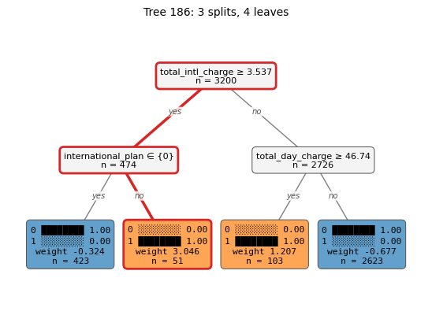
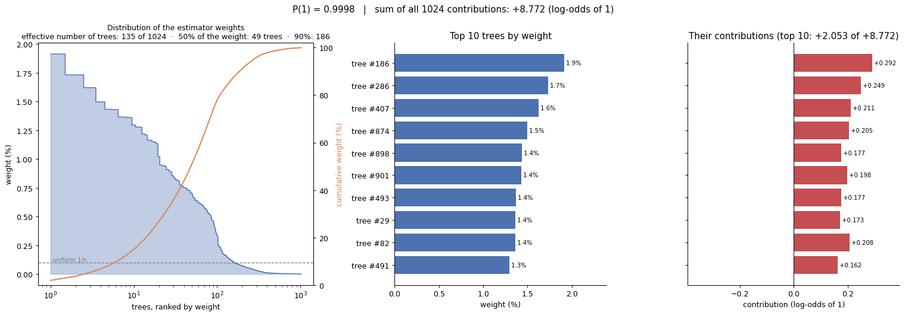

# 🌳 GRANDE: Gradient-Based Decision Tree Ensembles 🌳

[](https://pypi.org/project/GRANDE/) [](https://openreview.net/forum?id=XEFWBxi075) [](https://arxiv.org/abs/2309.17130)


<div align="center">



<p><strong>TabArena.</strong> The updated PyTorch GRANDE has been evaluated on TabArena and achieved strong results.</p>

</div>

🔍 What's new in version 1.0.0?
- **scikit-learn style API**: `GRANDEClassifier` and `GRANDERegressor` with `fit` / `predict` / `predict_proba`. They work with `clone`, `cross_val_score`, pipelines and pickling.
- **Standalone package**: no AutoGluon dependency. Runs on CPU and GPU.
- **TabArena search space**: the default configuration and the random search space used on TabArena ship with the package (see [Hyperparameter tuning](#hyperparameter-tuning)).
- **Inspection tools**: pruned trees on the original features, feature importances, per-sample estimator weights, Shapley-value feature attributions and readable rules (see [Looking inside the ensemble](#looking-inside-the-ensemble)).
- PyTorch-native implementation. The original TensorFlow version is available as `GRANDE<=0.1.6` on PyPI.
- Strong results on TabArena, especially for classification. Regression is currently weaker and is being worked on.
- Method updates for improved performance, including optional categorical and numerical embeddings.
- Training improvements (optimizers, schedulers, early stopping, optional SWA).
- Enhanced preprocessing pipeline with optional frequency encoding and robust normalization.

<div align="center">



<p><strong>Figure 1: Overview GRANDE.</strong> GRANDE learns hard, axis-aligned trees end-to-end via gradient descent, and uses dynamic instance-wise leaf weighting to combine estimators into a strong ensemble.</p>
</div>


🌳 GRANDE is a gradient-based decision tree ensemble for tabular data.
GRANDE trains ensembles of hard, axis-aligned decision trees end-to-end with gradient descent. Each estimator contributes via instance-wise leaf weights that are learned jointly with split locations and leaf values. This combines the strong inductive bias of trees with the flexibility of neural optimization. The PyTorch version optionally augments inputs with learnable categorical and numerical embeddings, improving representation capacity while preserving interpretability of splits.

📝 More details in the paper: https://openreview.net/forum?id=XEFWBxi075


## Installation

```bash
pip install git+https://github.com/s-marton/GRANDE.git
```

This installs the runtime dependencies (PyTorch, NumPy, pandas, scikit-learn, category-encoders,
rtdl-num-embeddings).
The plots of trees, feature importances and estimator weights additionally need matplotlib (`GRANDE[plot]`),
and the example notebooks also need OpenML, XGBoost and CatBoost (`GRANDE[examples]`):

```bash
pip install "GRANDE[plot] @ git+https://github.com/s-marton/GRANDE.git"
pip install "GRANDE[examples] @ git+https://github.com/s-marton/GRANDE.git"
```

A GPU is recommended, but GRANDE also runs on CPU.


## Quickstart

```python
from sklearn.datasets import load_breast_cancer
from sklearn.metrics import roc_auc_score
from sklearn.model_selection import train_test_split

from GRANDE import GRANDEClassifier

X, y = load_breast_cancer(return_X_y=True, as_frame=True)
X_train, X_test, y_train, y_test = train_test_split(X, y, test_size=0.2, random_state=42)
X_train, X_val, y_train, y_val = train_test_split(X_train, y_train, test_size=0.2, random_state=42)

model = GRANDEClassifier()  # TabArena default configuration, GPU if available
model.fit(X_train, y_train, X_val=X_val, y_val=y_val)  # the validation data is used for early stopping

proba = model.predict_proba(X_test)  # (n_samples, n_classes), columns follow model.classes_
print("ROC AUC:", roc_auc_score(y_test, proba[:, 1]))
```

Regression works the same way with `GRANDERegressor` and `predict`. More examples are in
[`examples/`](examples): [`quickstart.py`](examples/quickstart.py) and notebooks for
[binary](examples/notebooks/binary_classification.ipynb),
[multiclass](examples/notebooks/multiclass_classification.ipynb) and
[regression](examples/notebooks/regression.ipynb) tasks, which compare GRANDE with XGBoost and CatBoost, look inside
the fitted ensembles and tune the hyperparameters.

**Inputs.** `X` can be a pandas DataFrame or a numpy array. Columns with `category`, `object` or `string` dtype are
treated as categorical. Pass `cat_features=[...]` to `fit` to mark more columns, for example integer-coded categories in a
numpy array. Missing values are imputed by default. Preprocessing happens inside the estimator (encoding, imputation,
quantile / robust scaling), so raw data can be passed directly.

**Validation data.** If no `X_val` / `y_val` is given, a stratified `validation_fraction` (default 0.2) of the training
data is held out for early stopping.

**Device.** `device=None` uses the first GPU if one is available, otherwise the CPU. You can also pass `"cpu"` or
`"cuda:0"` explicitly. `model.to("cpu")` moves a fitted model.

**Compilation.** With `compile_model="auto"` (default) the network is compiled with `torch.compile`, on GPU and on
CPU. On CPU this needs a C++ compiler; without one, GRANDE runs in eager mode. Compiling takes roughly 10–30 s at the
start of a fit. In our measurements it then trains about 35× faster per epoch than eager mode on GPU, and 2.5–5× faster
on CPU, with about 10× faster predictions. For very small or quick experiments, `compile_model=False` avoids the
compile time.

**Time budget.** `fit(..., time_limit=600)` stops training after the epoch in which the budget is used up. The weights
of the best validation epoch are restored either way.

**Saving.** Estimators can be pickled, or saved with `model.save(path)` and loaded with
`GRANDEClassifier.load(path, device="cpu")`.

**scikit-learn tools.** Hyperparameters are plain constructor arguments, so `clone`, `GridSearchCV`,
`cross_val_score` and `Pipeline` work as usual.


## Looking inside the ensemble

GRANDE's trees are hard and axis-aligned, so a fitted model can be inspected like a classic tree ensemble.
The tools translate every split back to the **original features** (raw-value thresholds or category sets), even
though the network splits on preprocessed and embedded inputs.

```python
names = list(X_train.columns)                       # default names: x_1, x_2, ...
model.plot_tree(0, feature_names=names)             # tree 0 of the ensemble (pruned)
print(model.export_text(0, feature_names=names))    # the same tree as text
model.pruning_statistics()                          # effective / redundant / unreachable splits per tree

model.plot_feature_importances(X_test, feature_names=names)
model.compute_feature_importances(X_test)           # pandas Series, sums to 1; feature_importances_ needs no data

sample = X_test.iloc[[0]]
model.explain_instance(sample)                      # weight, leaf and contribution of every tree for one sample
model.plot_estimator_weights(sample)                # distribution of the weights, top trees, their contributions
model.plot_top_estimators(sample, k=3, feature_names=names)
model.apply(X_test)                                 # leaf index per sample and tree

background = X_train.sample(100, random_state=0)
att = model.explain_features(sample, background, feature_names=names)  # Shapley value of every feature
model.plot_feature_attributions(attributions=att)
model.extract_rules(X_train, y_train, top_k=10, feature_names=names)   # readable rules with coverage
```

- **Pruning.** Training leaves many splits whose outcome is the same for every value that can reach them:
  thresholds outside the range of the feature, and conditions that contradict or are implied by earlier splits on
  the path. `get_tree` / `plot_tree` / `export_text` remove them by default (`prune=False` shows the complete tree
  with redundant splits marked). Predictions within the range of the training data are unchanged.
- **Trees.** Split nodes show the condition of the *yes* branch (thresholds of features with only integer values
  in the training data are rounded up to the next integer, which is exact for integer inputs); leaves show the class distribution (or the
  regression value) and the leaf weight. `X=...` adds the number of samples per node, `highlight=sample` marks the
  decision path of a sample.
- **Feature importances** count how much each feature is used in the (effective) routing decisions: with data, every
  tree's instance-wise weight is shared among the splits on each sample's path; without data, by the probability of
  reaching each split.
- **Single predictions.** For each sample, every tree gets an instance-wise weight. `explain_instance` lists the
  weights and each tree's additive contribution (log-odds for binary classification, target units for regression).
- **Feature attributions.** `explain_features` computes interventional Shapley values with a background sample;
  they add up to the prediction minus the mean prediction over the background. Because the trees are weighted per
  sample, the output is not a sum over trees and TreeSHAP does not apply. Features that do not change any split
  for a background row are dropped (Shapley value 0); the remaining ones are enumerated exactly if there are at
  most `max_exact_features` (12) of them, otherwise sampled with antithetic permutations.
- **Rules.** `extract_rules` turns leaves into rules such as `bmi ≥ 29.36 AND smoker = yes`, ranked by the
  ensemble's weight on the leaf times the change of the prediction on the samples it covers (lift). The table
  reports coverage, weight share, lift and, with `y`, the precision (classification) or mean target (regression).
  Leaves of different trees that cover nearly the same samples are merged.

<div align="center">

<p><strong>A pruned tree</strong> of a GRANDE model for customer churn, with the decision path of one customer.</p>

<p><strong>Instance-wise estimator weights</strong> of one customer: distribution over the 1024 trees, the trees with
the highest weight and their contributions.</p>
</div>


## Hyperparameters

The defaults are the TabArena default configuration (`GRANDE.hpo.TABARENA_DEFAULT_PARAMS`). The most important
parameters:

| Group | Parameter | Default | Description |
| --- | --- | --- | --- |
| Ensemble | `depth` | 5 | Depth of each tree |
| | `n_estimators` | 1024 | Number of trees (trained jointly, so this is the exact ensemble size) |
| | `selected_variables` | 0.8 | Features per tree: fraction (clipped to 10–50 features) or absolute number |
| | `dropout` | 0.2 | Dropout on the instance-wise estimator weights |
| | `data_subset_fraction`, `bootstrap` | 1.0, False | Per-tree subsampling of each batch |
| Optimization | `learning_rate_values` / `_index` / `_leaf` / `_weights` | 0.01 / 0.01 / 0.01 / 0.005 | Learning rates of split thresholds, split features, leaf values and estimator weights |
| | `optimizer` | `"adam"` | `"adam"`, `"adamw"`, `"nadam"`, `"radam"` |
| | `epochs`, `batch_size`, `early_stopping_epochs` | 200, 256, 10 | Training length and early-stopping patience |
| | `es_metric` | False | Early stopping on ROC-AUC (binary) / MSE (regression) instead of the validation loss |
| | `cosine_decay_restarts`, `reduce_on_plateau_scheduler` | False, False | Learning-rate schedules (plateau reduction is only active together with cosine decay) |
| | `swa` | False | Stochastic weight averaging after epoch 10 |
| Embeddings | `use_numeric_embeddings`, `embedding_dim_num`, `num_emb_n_bins` | True, 4, 8 | Piecewise-linear embeddings of numeric features |
| | `use_category_embeddings`, `embedding_dim_cat`, `embedding_threshold` | False, 8, 1 | Embeddings of categorical features |
| | `learning_rate_embedding` | 0.001 | Learning rate of the embeddings |
| Preprocessing | `use_robust_scale_smoothing` | True | Robust scaling + smooth clipping (else a quantile transform) |
| | `loo_cardinality` | 10 | Categoricals with at least this many levels are leave-one-out encoded, others one-hot |
| | `missing_values` | False | Route missing values inside the trees instead of imputing them |
| Classification | `use_class_weights`, `focal_loss`, `label_smoothing` | False, False, 0.0 | Loss options |
| Runtime | `device`, `compile_model`, `n_threads`, `random_state`, `verbose` | None, "auto", None, 42, 0 | |

See `help(GRANDEClassifier)` for the full list.


## Hyperparameter tuning

GRANDE benefits from tuning. The random search space used on TabArena ships with the package:

```python
from GRANDE import GRANDEClassifier
from GRANDE.hpo import sample_configs

configs = sample_configs(n_configs=50, seed=1234)  # same space and seed as on TabArena
best = max(
    (GRANDEClassifier(**cfg).fit(X_train, y_train, X_val=X_val, y_val=y_val) for cfg in configs),
    key=lambda m: roc_auc_score(y_val, m.predict_proba(X_val)[:, 1]),
)
```

The search space samples the depth, the learning rates of the split thresholds, leaves and embeddings,
dropout, cosine decay, and whether numeric and/or categorical embeddings are used. It uses 250 epochs with patience 50
and early stopping on the task metric.


## Cite us
```text
@inproceedings{
marton2024grande,
title={{GRANDE}: Gradient-Based Decision Tree Ensembles},
author={Sascha Marton and Stefan L{\"u}dtke and Christian Bartelt and Heiner Stuckenschmidt},
booktitle={The Twelfth International Conference on Learning Representations},
year={2024},
url={https://openreview.net/forum?id=XEFWBxi075}
}
```

## More
If you encounter issues or unexpected behavior, please open an issue.
